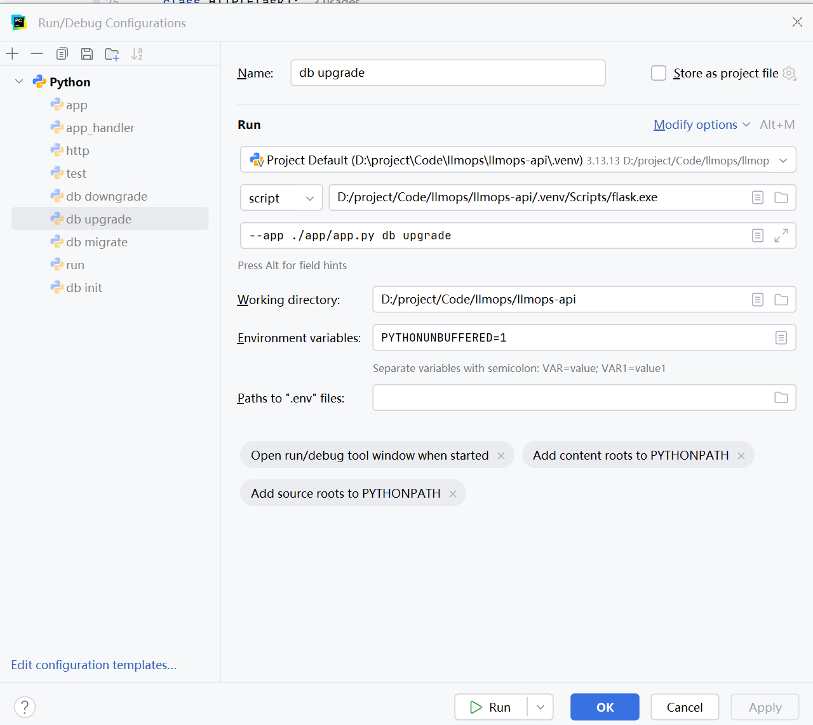

## 一、flask-migrate的主要作用？
`flask-migrate` 的主要作用是：对数据库进行版本管理的工具。
在业务增量比较大，我们不可能将数据库表结构在项目起始的时候，就设计的非常完美，所以数据库的版本迭代非常有必要，`flask-migrate` 就是解决数据库版本的这个问题。

## 二、安装指令
```shell
# 指定下载的镜像源
pip install flask-migrate -i https://pypi.tuna.tsinghua.edu.cn/simple  
```

## 三、在项目中依赖注入
**1、封装 migrate**
将 `flask-migrate`的封装在 `pkg` 中，所以在 `pkg` 下新建 `migrate.py` 文件，内容如下：
```py
from flask_migrate import Migrate

migrate = Migrate()
```

**2、在Http服务中注入**
```py
# 如下是伪代码
from flask_migrate import Migrate
from flask import Flask
from flask_sqlalchemy import SQLAlchemy
from injector import inject
from dataclasses import dataclass

@inject
@dataclass
class Http(Flask):
    def __init__(self, migrate: Migrate, db: SQLAlchemy):
        ...
        ...
        migrate.init_app(self, db, directory="./internal/migration")
        ...
        ...
```
**3、在Http实例化，进行依赖注入**
```py
# 如下是伪代码：
from injector import Injector, Module, Binder
from flask_sqlalchemy import SQLAlchemy
from flask_migrate import Migrate

class ExtensionModule(Module):
    def configure(self, binder: Binder):
        binder.bind(SQLAlchemy, db)
        binder.bind(Migrate, migrate)

injector = Injector([ExtensionModule])

app = Http(db: injector.get(SQLAlchemy), migrate: injector.get(Migrate))

...
...
```

**4、将自动创建表结构的代码删除，保留引入**
之前在`Http` 服务的代码中，为了保证在启动的时候，表结构的存在，所以会在`Http`服务中，增加如下代码：
```py
from internal.models import App

# 如下是伪代码
class Http:
    def __init__(self):
        ...
        ...
        with self.app_context():
            _ = App()
            db.create_all()
        ...
        ...
```
但是我们对于数据库管理采用了`flask-migrate`，所以就需要将这段代码注释掉，防止和`flask-migrate` 冲突。但是需要保留
`from internal.models import App` 保留引入。

## 四、执行指令
**1、初始化数据库**
在项目控制台执行：
```shell
flask --app ./app/app.py db init
```
`--app` 指定项目的入口文件。
这个操作目的就是完成 `migrate`的初始化，不会有任何操作，你可以理解为 `git init` 操作。

**2、提交数据库改动**
在项目控制台执行：
```shell
flask --app ./app/app.py db migrate -m "提交信息"
```
这个会基于入口文件，去扫描，将数据库的改动放到`internal/migrations`(前面传给migrate的路径)版本文件中，这个版本文件是一个hash值，如果“提交信息” 有值，则
版本文件的名称为：`hash值+提交信息.py`。在版本文件中会生成两个方法 `upgrade`和 `downgrade`，默认执行完 `migate` 方法并不会自动切到当前的版本，需要执行`upgrade` 操作。执行完成后，数据库中的`alembic_version` 表中的version会保存当前的版本文件的hash值。

**3、upgrade操作**
在项目控制台执行：
```shell
flask --app ./app/app.py db upgrade
```
这个操作是数据库版本的前进。

**4、downgrade操作**
在项目控制台执行：
```shell
flask --app ./app/app.py db downgrade
```
这个操作时数据库版本的回退。

## 五、如果对已有表新增字段如何实现。
- 只需要在`internal/models`文件夹中找到你的表结构，让直接加上某一个字段。
- 执行 `flask --app ./app/app.py db migrate -m ""`
- 执行 `flask --app ./app/app.py db upgrade`

## 六、将上述代码指令放到配置文件中
这里以 `upgrade` 为例，其余的同理。


## 七、扩展指令
- 如果想要回退到最初的版本，直接执行 `flask --app ./app/app.py db downgrade base`
- 如果想要前进到某一个版本，直接执行 `flask --app ./app/app.py db upgrade <hash值>`