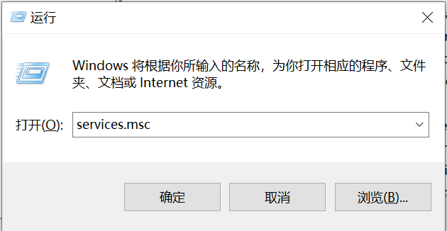
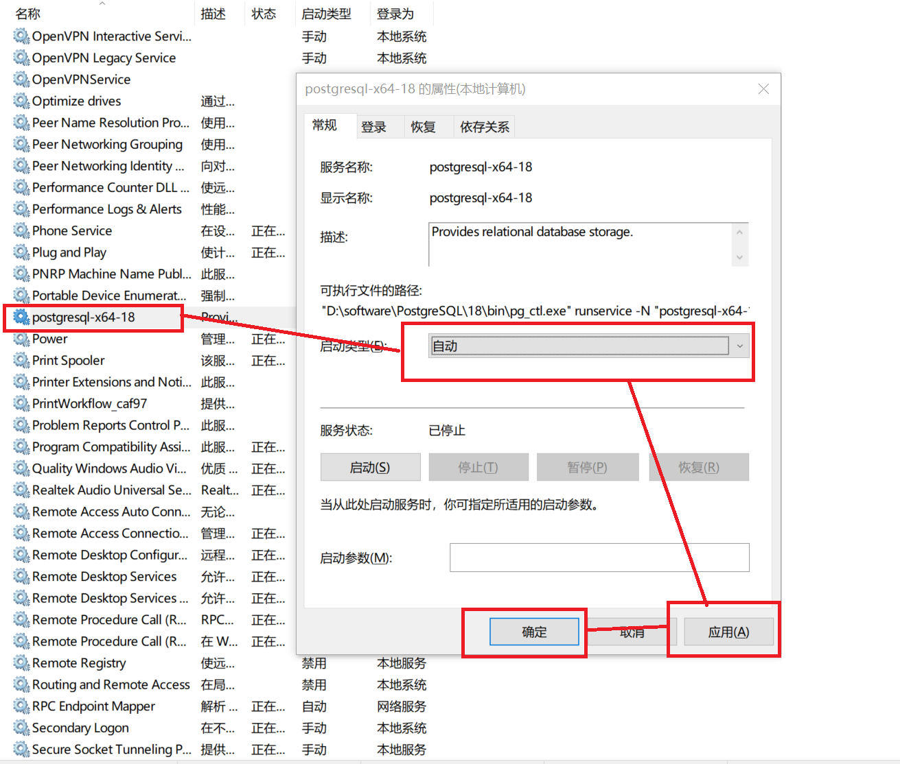
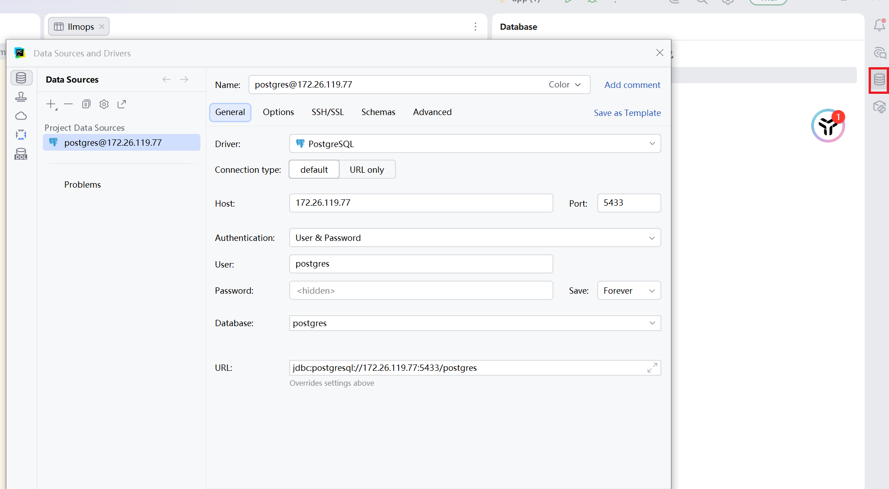
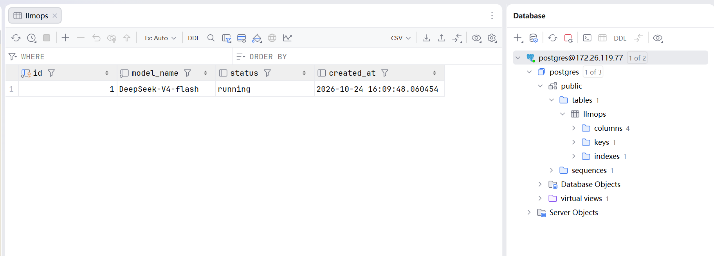

## 一、Windows 下部署 PostgreSQL

### 1、安装 PostgreSQL 程序

安装地址：[PostgreSQL 官网](https://www.postgresql.org/download/windows/)，下载 exe 安装包后直接点击安装，一路「下一步」即可完成。

### 2、开启/关闭开机自启

**（1）Win + R 键入 `services.msc`**



**（2）在服务中设置**



### 3、PostgreSQL 启停脚本封装

将 PostgreSQL 的启动和关闭封装成 `.bat` 文件，双击即可执行（脚本中的路径按实际安装位置调整）。

**（1）启动脚本**

```bat
@echo off
"D:\software\PostgreSQL\18\bin\pg_ctl.exe" start -D "D:\software\PostgreSQL\18\data" -l "D:\software\PostgreSQL\18\data\pg.log"
pause
```

**（2）关闭脚本**

```bat
@echo off
"D:\software\PostgreSQL\18\bin\pg_ctl.exe" stop -D "D:\software\PostgreSQL\18\data" -m fast
pause
```

## 二、在 Linux 中部署 PostgreSQL

### 1、安装

```shell
sudo apt update

sudo apt install postgresql postgresql-contrib
```

### 2、查看状态

```shell
sudo systemctl status postgresql
```

### 3、切换到 postgres 用户

```shell
su - postgres
```

### 4、进入到 postgres 数据库中

```shell
psql
```

### 5、查看表

```shell
\dt
```

### 6、退出

```shell
\q
```

### 7、让其他系统用户也能登录 PostgreSQL

安装 PostgreSQL 后，系统会自动创建一个 `postgres` 用户，默认必须登录到该用户才能连接数据库。如果想要在其他用户下也可以连接数据库，需要按下面的步骤配置。

**（1）设置账号密码**

登录到 postgres 用户下，设置用户连接数据库的账号密码。

```sql
ALTER USER postgres WITH PASSWORD '123456';
```

**（2）修改认证配置文件**

```shell
nano /etc/postgresql/16/main/pg_hba.conf
```

**（3）找到并修改这两行**

- `local all postgres peer` 改为 `local all postgres md5`
- `host all all 127.0.0.1/32 scram-sha-256` 改为 `host all all 0.0.0.0/0 md5`

> 注意：如果只需要本机其他用户登录，保留 `127.0.0.1/32` 更安全；`0.0.0.0/0` 会对所有 IPv4 来源地址开放，生产环境需配合防火墙白名单使用。另外 PostgreSQL 14 及以上版本默认密码加密方式为 `scram-sha-256`，`md5` 规则遇到 scram 密码时会自动按 `scram-sha-256` 完成校验。

**（4）保存并退出**

按 `Ctrl + O` 保存（按回车确认文件名），然后按 `Ctrl + X` 退出。

**（5）重启数据库服务**

```shell
systemctl restart postgresql
```

**（6）其他用户登录**

在其他用户下执行：

```shell
psql -U postgres -h 127.0.0.1
```

### 8、peer / md5 / password / trust 的区别

| 认证方式 | 说明 |
| --- | --- |
| `peer` | 必须在当前 `postgres` 系统用户下登录 |
| `md5` | 必须通过账号密码登录，密文传输 |
| `password` | 必须通过账号密码登录，明文传输，不安全 |
| `trust` | 不需要任何校验逻辑，可以直接登录，非常不安全，生产环境**禁用** |

## 三、在 Docker 容器中启动 PostgreSQL 服务

### 1、检查 Docker 版本

```shell
docker -v
```

### 2、拉取 postgres:16 镜像

```shell
docker pull postgres:16
```

> 这里有一个点需要注意：如果 Docker Hub 需要连接代理才能访问，此时在宿主机中开启了代理，但虚拟机中无法通过代理访问，可以查看【Ubuntu 虚拟机通过 Windows Clash 访问外网实战】这篇文章。

### 3、查看镜像

```shell
docker images
```

### 4、启动容器

```shell
docker run -d \
  --name pg-docker \
  -e POSTGRES_USER=postgres \
  -e POSTGRES_PASSWORD=postgres \
  -e POSTGRES_DB=llmops \
  -p 5433:5432 \
  -v pg_data:/var/lib/postgresql/data \
  postgres:16
```

### 5、进入容器并连接数据库

```shell
docker exec -it pg-docker psql -U postgres -d postgres
```

### 6、创建表并插入数据

```sql
-- 建表
CREATE TABLE llmops (
    id SERIAL PRIMARY KEY,
    model_name VARCHAR(50) NOT NULL,
    status VARCHAR(20),
    created_at TIMESTAMP DEFAULT CURRENT_TIMESTAMP
);

-- 插入数据
INSERT INTO llmops (model_name, status) VALUES ('DeepSeek-V3', 'running');

-- 查询数据
SELECT * FROM llmops;
```

### 7、在宿主机 PyCharm 中连接虚拟机容器内的数据库

**（1）操作步骤**



这里 `Host` 的值通过在虚拟机控制台执行 `ip addr` 获取，因为在同一网段下，所以可以直接访问。

**（2）结果**


