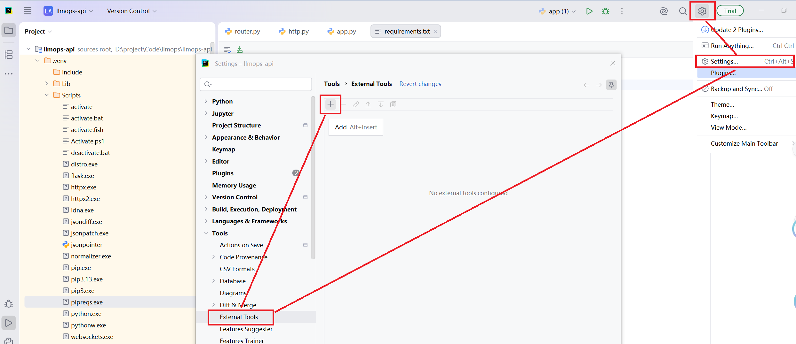
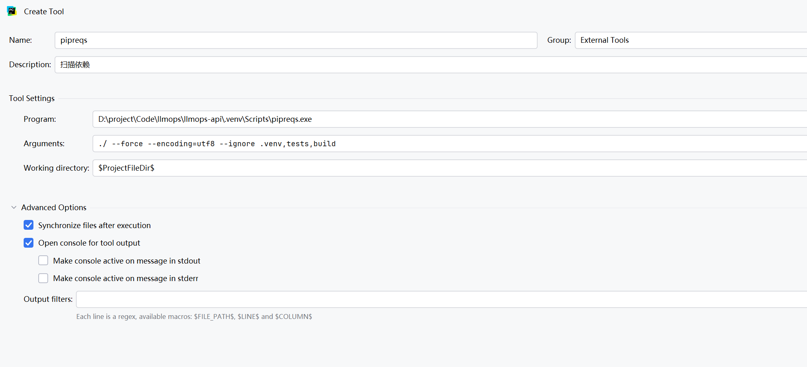
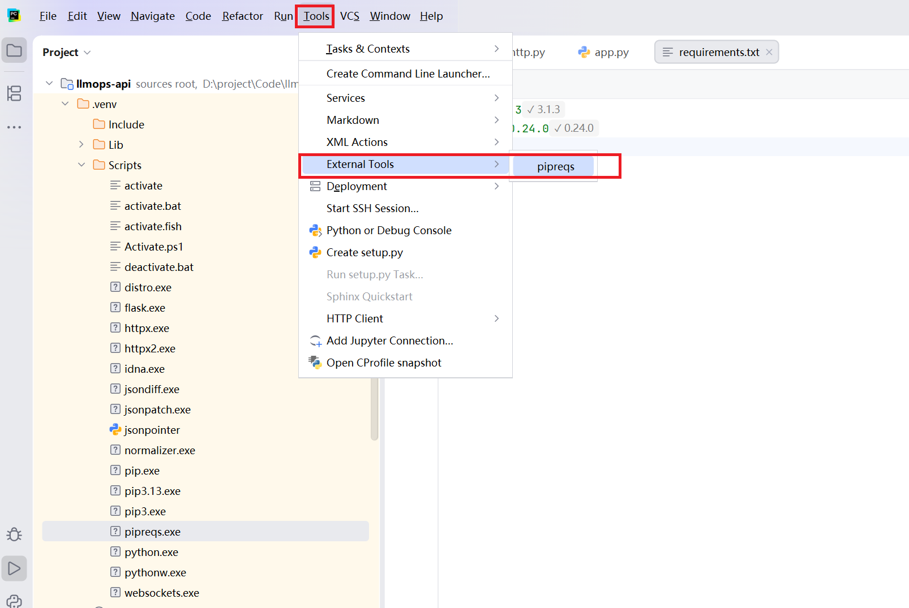

## 一、python依赖收集的两种方法
### 1、pip freeze
`pip freeze` 主要是收集项目的全部依赖，但是存在的问题是，依赖有点多，并不是我们项目中的真实的依赖情况，比如说我们项目中依赖了包A，但是包A依赖了包B，此时在配置文件中
包B也包含在内。不符合我们正常开发的需求。

### 2、pipreqs
通过 `pipreqs` 就可以收集项目中真实依赖的包资源，它会将项目中通过 `import` 导入的包全部都收集在一起放在 `requirements.txt` 中。
在使用之前需要通过 `pip` 进行安装。
```shell
pip install pipreqs
```

## 二、pipreqs参数
### 1、--force
这个参数主要作用就是强制覆盖 `requirements.txt` 文件。

### 2、--encoding=utf8
采用utf-8编码模式，防止编码错误

### 3、--ignore
忽略检索文件 一般会忽略 `.venv` 文件夹。

所以最终指令为：
```shell
pipreqs ./ --force --encoding=utf8 --ignore .venv
```

也可以在 `pycharm` 编辑器中将上面指令设置为**外部工具**。

## 三、将 pipreqs 指令设置为外部工具。
### 1、找到配置扩展文件地方


### 2、编写配置文件


### 3、运行
