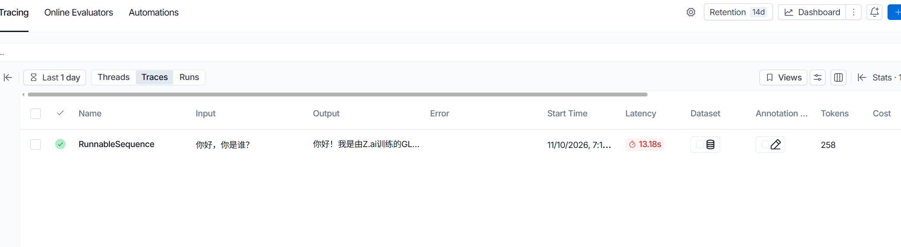
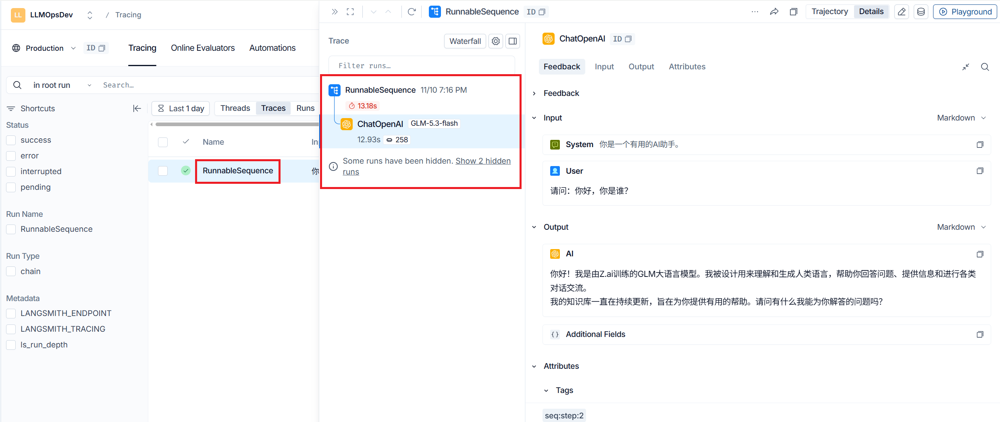

## 一、langsmith的作用
`langsmith`的主要作用是在做`日志监控与追踪`、`提示词管理`、`调试`、`部署`，这里主要讲述的是**AI链路的日志监控与追踪**。

## 二、使用
### 1、安装依赖包
```shell
pip install langchain langchain_core
```

### 2、配置env环境变量
```.env
# langsmith
LANGSMITH_TRACING=true
LANGSMITH_ENDPOINT=https://api.smith.langchain.com
LANGSMITH_API_KEY=
LANGSMITH_AGENT_ID=llmopsdev
LANGSMITH_AGENT_ENVIRONMENT=production
```
这里的其他环境都不动，`LANGSMITH_API_KEY` 自动取来自：
`https://smith.langchain.com/o/82b7d201-c06b-4883-92a1-4d062aae5a20/settings/apikeys` 这个路由下创建的 `API_Key`

### 3、启动服务调用接口


### 4、显示调用信息
